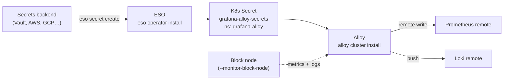

# Alloy & Secrets Commands

Grafana Alloy ships this cluster's metrics and logs to remote Prometheus and Loki endpoints.
External Secrets Operator (ESO) is how you get the passwords for those endpoints into the
cluster without writing them into a values file.

Both live here because you almost always set them up together.

> **Flags not listed on this page.** Every command here also accepts the
> [global flags](../reference/global-flags.md) — `--config`, `--output`, `--log-level`,
> `--force`, `--verbose`, `--non-interactive`.
>
> **`--profile`** is available on `alloy cluster`. It is optional here — it sets the
> `environment` label for the `ops` label profile, unless `--environment` is given. See
> [Deployment profiles](../reference/deployment-profiles.md).

## How the pieces fit



You can create the Secret by hand with `kubectl` instead of using ESO. Alloy does not care
where it came from.

---

# Alloy

## Prerequisites

Needed only when you configure remotes (`--add-prometheus-remote` / `--add-loki-remote`):

| Prerequisite | Detail |
|---|---|
| A running Kubernetes cluster | From `block node install` or `kube cluster install`. Alloy deploys into an existing cluster; it never creates one |
| The `grafana-alloy-secrets` Secret | In the `grafana-alloy` namespace, with a password key per remote |
| Reachable remote endpoints | The Prometheus/Loki URLs must be reachable from inside the cluster |
| A block node (optional) | Only if you pass `--monitor-block-node` |

> **Without any remote flags, Alloy installs with no remotes and needs no Secret.** That is a
> valid way to start.

## `alloy cluster install`

```bash
# Step 1 — create the Secret with a password per remote
kubectl create namespace grafana-alloy
kubectl create secret generic grafana-alloy-secrets \
  --namespace=grafana-alloy \
  --from-literal=PROMETHEUS_PASSWORD_PRIMARY=<password> \
  --from-literal=LOKI_PASSWORD_PRIMARY=<password>

# Step 2 — install Alloy with remotes
sudo solo-provisioner alloy cluster install \
  --cluster-name=mainnet-block-01 \
  --profile=mainnet \
  --add-prometheus-remote=name=primary,url=https://prom1.example.com/api/v1/write,username=user1 \
  --add-loki-remote=name=primary,url=https://loki1.example.com/loki/api/v1/push,username=user1 \
  --monitor-block-node

# Or: install with no remotes at all (no Secret needed)
sudo solo-provisioner alloy cluster install --cluster-name=mainnet-block-01
```

| Flag | What it does |
|---|---|
| `--cluster-name` | Cluster name used as a label on every metric and log stream |
| `--profile`, `-p` | Deployment profile. Sets the `environment` label for the `ops` label profile. Optional — falls back to `--config` |
| `--environment` | Environment label for the `ops` label profile; defaults to `--profile`. Free-form, e.g. `staging`, `qa`. Can also be set as `alloy.environment` in `--config` |
| `--monitor-block-node` | Turn on block-node-specific monitoring |
| `--add-prometheus-remote` | Add a Prometheus remote. Repeatable. See [remote format](#remote-format) |
| `--add-loki-remote` | Add a Loki remote. Repeatable |
| `--stop-on-error` | Stop at the first failing step (default) |
| `--rollback-on-error` | Undo completed steps on failure |
| `--continue-on-error` | Keep going past failures |

### Deprecated flags

| Deprecated | Use instead |
|---|---|
| `--prometheus-url`, `--prometheus-username` | `--add-prometheus-remote` |
| `--loki-url`, `--loki-username` | `--add-loki-remote` |

The three error-handling flags are mutually exclusive and apply to both `alloy cluster
install` and `alloy cluster uninstall`. See [Global flags](../reference/global-flags.md#error-handling-flags).

## Remote format

```
name=<name>,url=<url>,username=<username>[,labelProfile=eng|ops]
```

| Key | Meaning |
|---|---|
| `name` | Unique identifier for the remote: `primary`, `backup`, `grafana-cloud` |
| `url` | Remote write / push endpoint |
| `username` | Auth username. The **password comes from the K8s Secret**, never the flag |
| `labelProfile` | Optional. `eng` (default) or `ops`. See [Label profiles](#label-profiles) |

### Secret key naming

Each remote needs a matching password key, named from the remote type and name:

- Prometheus: `PROMETHEUS_PASSWORD_<REMOTE_NAME>`
- Loki: `LOKI_PASSWORD_<REMOTE_NAME>`

So a cluster with `primary` and `backup` remotes needs four keys:

```bash
kubectl create namespace grafana-alloy
kubectl create secret generic grafana-alloy-secrets \
  --namespace=grafana-alloy \
  --from-literal=PROMETHEUS_PASSWORD_PRIMARY=<password> \
  --from-literal=PROMETHEUS_PASSWORD_BACKUP=<password> \
  --from-literal=LOKI_PASSWORD_PRIMARY=<password> \
  --from-literal=LOKI_PASSWORD_BACKUP=<password>
```

## Changing remotes

`alloy cluster install` is **declarative**. Every run replaces the entire remote
configuration with what you pass. There is no add/remove verb.

**Always list every remote you want to keep.**

| To do this | Do this |
|---|---|
| Add a remote | Re-run with all existing remotes **plus** the new one |
| Remove a remote | Re-run and simply omit it |
| Change a URL | Re-run with the same `name` and the new `url` |
| Remove all remotes | Re-run with no remote flags |

```bash
# You had 'primary'; you want 'primary' and 'backup'
sudo solo-provisioner alloy cluster install \
  --cluster-name=mainnet-block-01 \
  --add-prometheus-remote=name=primary,url=https://prom1.example.com/api/v1/write,username=user1 \
  --add-prometheus-remote=name=backup,url=https://prom2.example.com/api/v1/write,username=user2 \
  --add-loki-remote=name=primary,url=https://loki1.example.com/loki/api/v1/push,username=user1

# Now drop 'backup' again — just leave it out
sudo solo-provisioner alloy cluster install \
  --cluster-name=mainnet-block-01 \
  --add-prometheus-remote=name=primary,url=https://prom1.example.com/api/v1/write,username=user1 \
  --add-loki-remote=name=primary,url=https://loki1.example.com/loki/api/v1/push,username=user1
```

## Label profiles

A label profile auto-injects extra labels into every metric and log stream. Set it per remote
with the optional `labelProfile` key.

| Profile | Labels added |
|---|---|
| `eng` *(default)* | `cluster` |
| `ops` | `cluster`, `environment`, `instance`, `instance_type`, `inventory_name`, `ip` (when available) |

```bash
sudo solo-provisioner alloy cluster install \
  --cluster-name=lfh02-previewnet-blocknode \
  --profile=previewnet \
  --add-prometheus-remote=name=primary,url=https://prom.example.com/api/v1/write,username=user1,labelProfile=ops \
  --add-loki-remote=name=primary,url=https://loki.example.com/loki/api/v1/push,username=user1,labelProfile=ops \
  --monitor-block-node
```

With `--cluster-name=lfh02-previewnet-blocknode` and `--profile=previewnet`, `ops` derives:

| Label | Value | Where it comes from |
|---|---|---|
| `cluster` | `lfh02-previewnet-blocknode` | `--cluster-name`. Always set |
| `environment` | `previewnet` | `--environment` if set, else `alloy.environment` in `--config`, else `--profile` |
| `instance` | `lfh02-previewnet-blocknode` | Full cluster name. Overrides the auto-scraped `IP:port` |
| `instance_type` | `lfh` | Alphabetic prefix of the first segment of the cluster name |
| `inventory_name` | `lfh02-previewnet-blocknode` | Full cluster name |
| `ip` | `<ip>` | Optional. Set when an IP label is available for the node |

Each remote carries its own `labelProfile`. Omitting it means `eng`.

### Environments outside the deployment profiles

`--profile` only accepts the five deployment profiles. For any other environment name
(`staging`, `qa`, a tenant name), set the label directly with `--environment`. It accepts
letters, digits, `-` and `.`, and only affects remotes using `labelProfile=ops`:

```bash
sudo solo-provisioner alloy cluster install \
  --cluster-name=lfh05-staging-blocknode \
  --environment=staging \
  --add-prometheus-remote=name=primary,url=https://prom.example.com/api/v1/write,username=user1,labelProfile=ops
```

This emits `environment="staging"`. The label is not remembered between runs — pass
`--environment` again (or set `alloy.environment` in `--config`) on every reinstall.

More detail: [`docs/dev/label_profiles.md`](../dev/label_profiles.md).

## `alloy cluster uninstall`

```bash
sudo solo-provisioner alloy cluster uninstall
```

---

# External Secrets Operator (ESO)

ESO syncs secrets from an external store into Kubernetes. Install it once per cluster, then
declare an `ExternalSecret` per secret you need — including `grafana-alloy-secrets`.

## Prerequisites

| Prerequisite | Detail |
|---|---|
| Root privileges | The install command needs `sudo` |
| A reachable cluster | Via the admin kubeconfig |

## `eso operator install`

Installs the `external-secrets/external-secrets` Helm chart. The chart version is pinned by
the infrastructure catalog. Chart 2.13.0 runs the image `ghcr.io/external-secrets/external-secrets:v2.13.0`
for the controller, webhook and cert controller; mirror it there for hosts without access to ghcr.io. Idempotent: if ESO is already in the target namespace, the install
is skipped with a clear message.

> **ESO is one per cluster.** Its CRDs are cluster-scoped, so a second instance cannot coexist
> with the first. The install is refused before Helm changes anything — rather than failing
> partway through on a CRD ownership error and leaving the new namespace behind — when:
>
> * ESO already exists elsewhere in the cluster, in another namespace or under another release name;
> * the release in the target namespace is left in a failed, pending or uninstalled state;
> * the `external-secrets` release name in the target namespace belongs to a different chart.
> * ESO CRDs already exist but no ESO Helm release does — ESO managed by another tool, or one whose release record was lost. Installing would take that ESO over, so the install stops and names the CRDs. When every one of those CRDs is being deleted, a previous uninstall stopped partway: see [Recover from a partial uninstall](#recover-from-a-partial-uninstall).
> * the ESO release exists but an ESO CRD is still being deleted, or the release a recovery installed lacks one of its CRDs — a recovery from a partial uninstall that failed or was interrupted. The message names the CRDs and the command that finishes the recovery. A CRD missing from a release no recovery installed (deleted by hand, for example) only gets a warning.
>
> Each message names the release and namespace that are in the way, and the command to clear it. For the
> first two cases that is `sudo solo-provisioner eso operator uninstall --namespace <namespace>`,
> which removes the ESO release in that namespace whatever its name and state. The third case —
> a different chart holding the `external-secrets` release name — needs raw
> `helm uninstall <release> -n <namespace>`: the uninstall command will not remove a chart that
> is not ESO.

```bash
# Default namespace: external-secrets
sudo solo-provisioner eso operator install

# Custom namespace
sudo solo-provisioner eso operator install --namespace my-eso

# Reinstall over a partial uninstall, after detaching the Secrets to keep
sudo solo-provisioner eso operator install --recover-partial-uninstall
```

| Flag | What it does | Default |
|---|---|---|
| `--namespace` | Namespace for the operator | `external-secrets` |
| `--recover-partial-uninstall` | Reinstall over a [partial uninstall](#recover-from-a-partial-uninstall): one that removed the Helm release but left the External Secrets Operator CRDs being deleted. Refused while a Secret is still owned by an ExternalSecret or a PushSecret has `deletionPolicy: Delete` | `false` |
| `--stop-on-error` | Stop at the first failing step (default) | — |
| `--rollback-on-error` | Undo completed steps on failure | — |
| `--continue-on-error` | Keep going past failures | — |

## `eso operator uninstall`

```bash
sudo solo-provisioner eso operator uninstall
sudo solo-provisioner eso operator uninstall --namespace my-eso
```

| Flag | What it does | Default |
|---|---|---|
| `--namespace` | Namespace to uninstall from | `external-secrets` |
| `--stop-on-error` | Stop at the first failing step (default) | — |
| `--rollback-on-error` | Undo completed steps on failure | — |
| `--continue-on-error` | Keep going past failures | — |

> **The uninstall refuses while ESO objects hold finalizers.** ESO puts a cleanup finalizer on
> every `ExternalSecret`, `ClusterExternalSecret` and `GeneratorState`, and on each `PushSecret`
> with `deletionPolicy: Delete`; only the ESO controller removes it. The chart deletes the controller and the CRDs together, so an
> uninstall over such objects would leave a **partial uninstall**: the Helm release gone, the
> `ExternalSecret` CRD stuck `Terminating`, and a reinstall refused. So before changing anything
> the uninstall lists those objects across the cluster, names up to ten of them, and stops.
> `--force` and `--non-interactive` do not skip this check.
>
> 1. See what still uses them: `kubectl get externalsecrets.external-secrets.io -A`, and the
>    other kinds the message names.
> 2. Delete each `ExternalSecret` you no longer need with `eso secret delete`. That also deletes
>    the Kubernetes Secret it synced. Delete the other kinds with `kubectl delete`.
> 3. When none are left, run `eso operator uninstall` again.
>
> If the message marks objects as `deleting`, they are waiting for the controller. Check
> `kubectl get pods -n <namespace>`: while it runs they clear within a minute. If the release is
> not `deployed` and some objects are not yet deleting, there is no supported way yet to repair
> it from the CLI; do not uninstall over them. When every object is already deleting, the
> uninstall goes ahead on a `failed`, `pending` or `uninstalling` release, because those objects
> go anyway: then [recover from the partial uninstall](#recover-from-a-partial-uninstall).
>
> A `PushSecret` created by a `ClusterPushSecret` comes back from it: change or delete the
> `ClusterPushSecret` instead (`kubectl get clusterpushsecrets.external-secrets.io`).

> **When it runs, the uninstall deletes every store.** Removing ESO's cluster-scoped CRDs
> deletes every `SecretStore` and `ClusterSecretStore` in the cluster.

The target is the ESO release **in `--namespace`**, found by chart name — so this clears an ESO
installed under a different release name (a hand-run `helm install my-eso`, or a controller such
as Flux that installs through Helm and leaves a release record), and one left in a `failed`,
`pending-*`, `uninstalling` or `uninstalled` state. A deployment that renders the chart and
applies the manifests itself, as Argo CD does by default, leaves no Helm release, so this command
cannot see it. It never reaches outside the namespace you name.

Idempotent: if that namespace holds no ESO, the uninstall is skipped and the command exits 0.
That includes the case where a *different* chart holds the `external-secrets` release name — it
is left untouched, with a warning naming it; remove that one with `helm uninstall`. If no ESO
release exists but the `ExternalSecret` CRD is still being deleted, the run summary warns that a
previous uninstall stopped partway.

### Recover from a partial uninstall

Uninstalls by earlier releases did not check for finalized objects, so a cluster can be left with
no ESO release, the `externalsecrets.external-secrets.io` CRD stuck `Terminating`, its
`ExternalSecret`s waiting on finalizers, and the synced Secrets still in place. Most other ESO
objects are already gone, because their CRDs finished deleting. A `PushSecret` with
`deletionPolicy: Delete` and the store it pushes to survive, and their CRDs stay `Terminating`
too. `eso operator install` refuses in this state. It names the CRDs, the Secrets and
`PushSecret`s you must protect first, and the `GeneratorState`s a recovery would clean up, and
points here.

The way out is to bring a controller back so it clears the finalizers itself. That lets the
`ExternalSecret`s finish deleting, and Kubernetes then deletes every Secret they still own, so
detach the Secrets you need first.

1. Confirm the state. `helm list -a -n external-secrets` shows no ESO release, and this prints
   a time. If it shows the release as `uninstalling` or `failed` (an interrupted uninstall, or a
   failed recovery), run `eso operator uninstall` first to remove the record.

   ```bash
   kubectl get crd externalsecrets.external-secrets.io -o jsonpath='{.metadata.deletionTimestamp}'
   ```

2. List the stuck `ExternalSecret`s. Each one's Secret has the name in its
   `spec.target.name`, or the `ExternalSecret`'s own name when that is empty.

   ```bash
   kubectl get externalsecrets.external-secrets.io -A
   ```

3. Detach each Secret you need to keep by removing its `ExternalSecret` owner reference. Its
   data stays as it is. The install refusal prints this command for each Secret, with the
   index and uid filled in; the `test` step makes kubectl refuse if the owner references
   changed since, so no other owner is removed.

   ```bash
   kubectl patch secret <secret> -n <namespace> --type=json \
     -p '[{"op":"test","path":"/metadata/ownerReferences/<i>/uid","value":"<uid>"},{"op":"remove","path":"/metadata/ownerReferences/<i>"}]'
   ```

   A `PushSecret` with `deletionPolicy: Delete` would delete its pushed secret in the remote
   store once a controller is back, so set each one to `None` first. A `GeneratorState` has no
   such setting: the controller cleans up what its generator created, and an install without
   `--recover-partial-uninstall` names them before you recover.

   ```bash
   kubectl get pushsecrets.external-secrets.io -A
   kubectl patch pushsecrets.external-secrets.io <name> -n <namespace> --type=merge \
     -p '{"spec":{"deletionPolicy":"None"}}'
   ```

4. Reinstall over the partial uninstall. The install refuses, naming each one, while any Secret
   is still owned by an `ExternalSecret` or any `PushSecret` still has `deletionPolicy: Delete`.
   It installs the chart, waits up to 5 minutes for the old CRDs to finish deleting, then
   uninstalls and installs ESO again to restore every CRD, and exits 0 with a warning to
   recreate the stores and `ExternalSecret`s. If it times out or is interrupted, run it again:
   it picks the recovery back up, also when the old CRDs finished deleting in between.

   ```bash
   sudo solo-provisioner eso operator install --recover-partial-uninstall
   ```

5. Recreate the stores that are gone, then each `ExternalSecret` with the same name, namespace and
   target, for example with `eso secret create`. ESO takes the existing Secret back without changing its
   data.

Do not remove finalizers or delete the CRDs by hand to get past a partial uninstall. That skips
ESO's cleanup, and on a production cluster deleting the CRDs deletes every resource of those
kinds and the Secrets they own.

The three error-handling flags are mutually exclusive and apply to both `eso operator
install` and `eso operator uninstall`. See
[Global flags](../reference/global-flags.md#error-handling-flags).

> **`--rollback-on-error` is not the same as Helm's own rollback.** The install already
> runs Helm atomically (except the first install of a recovery from a partial uninstall),
> so a *failed* chart install reverts itself. The flag matters when
> the install succeeds and a later step fails — for example the readiness wait timing out —
> in which case it uninstalls the release this run created. Rollback is not shown in the
> TUI; confirm it with `helm list -A` or the workflow report named in `report_path=…`.

## `eso secret create`

Creates or updates an `ExternalSecret`, which ESO reconciles into a Kubernetes Secret. It uses
server-side apply, so re-running with the same `--name`/`--namespace` updates in place.

```bash
sudo solo-provisioner eso secret create \
  --store=vault-store \
  --name=grafana-alloy-secrets \
  --namespace=grafana-alloy \
  --set PROMETHEUS_PASSWORD_PRIMARY=secret/data/grafana/alloy/prod/prometheus/primary#password \
  --set LOKI_PASSWORD_PRIMARY=secret/data/grafana/alloy/prod/loki/primary#password
```

| Flag | What it does | Default |
|---|---|---|
| `--store` | **Required.** Name of the `ClusterSecretStore` to sync from | — |
| `--name` | **Required.** Name of the resulting Secret (and the ExternalSecret) | — |
| `--namespace` | **Required.** Namespace for both | — |
| `--set` | **At least one required.** Map a Secret key to a store path: `KEY=store/path[#field]`. Repeatable | — |
| `--refresh-interval` | How often ESO re-syncs from the store | `1h` |

> **The `ClusterSecretStore` named by `--store` and the target `--namespace` must already
> exist.** The store points at your secrets backend (Vault, AWS, GCP, …). Setting it up is
> cluster-operator configuration and is out of scope for this command.

## `eso secret delete`

Deletes an `ExternalSecret`. For ExternalSecrets created by `eso secret create`, the Kubernetes
Secret goes with it: that manifest sets `creationPolicy: Owner`, so the Secret carries an
`ownerReference` and Kubernetes garbage-collects it once its owner is gone. An ExternalSecret
created outside this CLI without that policy is still deleted, but its Secret is left behind.

```bash
sudo solo-provisioner eso secret delete \
  --name=grafana-alloy-secrets \
  --namespace=grafana-alloy
```

| Flag | What it does | Default |
|---|---|---|
| `--name` | **Required.** Name of the resulting Kubernetes Secret (and the ExternalSecret) | — |
| `--namespace` | **Required.** Namespace for both the ExternalSecret and the Kubernetes Secret | — |

Verify both are gone:

```bash
sudo KUBECONFIG=/etc/kubernetes/admin.conf kubectl get externalsecret,secret -n grafana-alloy
```

> **Garbage collection is asynchronous.** The command returns as soon as the ExternalSecret is
> deleted, so the Secret may briefly outlive it. Re-run the check if it still appears.

Idempotent: if the ExternalSecret does not exist, the deletion is skipped and the command exits
0. A namespace that does not exist is treated the same way — there is nothing to delete.

> **One exception — uninstall the secrets before the operator.** If ESO has been uninstalled the
> command *fails* rather than skipping: removing ESO removes its CRDs, so `ExternalSecret` is no
> longer a kind the cluster recognises, and a kind that cannot be resolved is reported as an error
> rather than silently treated as "already gone".

---

## See also

- [Block node commands](block-node.md) — what `--monitor-block-node` monitors
- [Configuration](../reference/configuration.md) — the `alloy:` config-file section
- [Troubleshooting](../troubleshooting.md)
