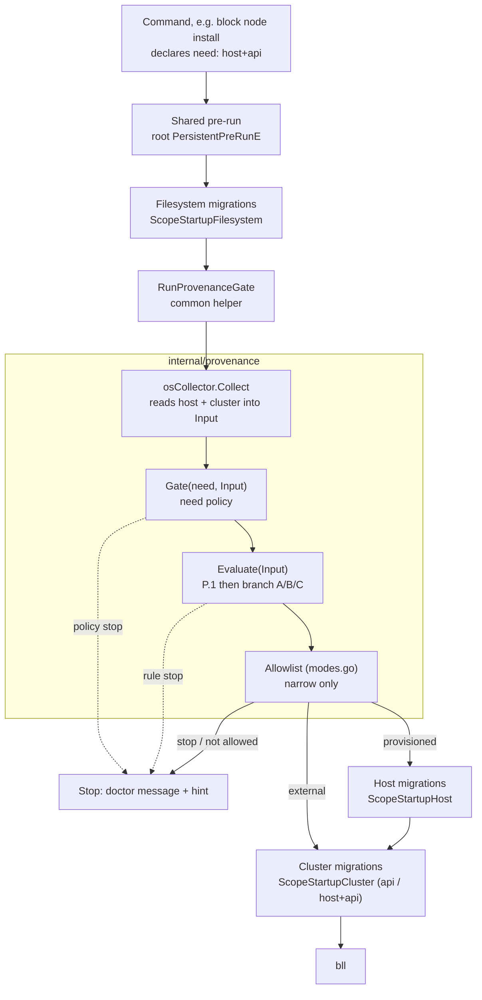
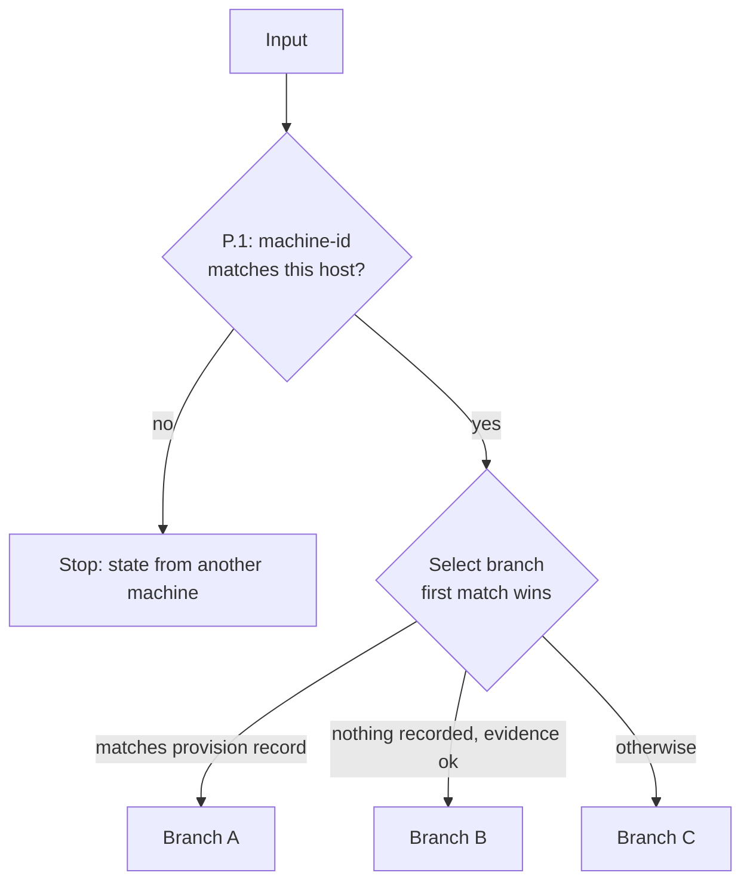

# Provenance gate

The provenance gate decides which cluster a command is about and whether this
host provisioned it, **before** any real work runs. It establishes the provenance
of the target so state and reality can be trusted; it is not a security boundary.

This documents the `internal/provenance` package and how its pieces interact. For
the design rationale, the startup order, and the full outcome table, see
[bring-your-own-cluster.md](./bring-your-own-cluster.md) section 5.

## Vocabulary

| Term | Meaning |
|---|---|
| `HostIdentity` | the machine — `/etc/machine-id` |
| `ClusterIdentity` | the cluster — the `kube-system` UID (plus server and CA fingerprint) |
| provision record | what this host recorded about the cluster it provisioned, in `host.yaml` |
| `Target` | the cluster a command is pointed at |
| `Origin` | the verdict: `provisioned` or `external`. A refusal is a stop, not an origin |

## Pipeline: one command through the gate

`RunProvenanceGate` (in the `common` package) is the entry point; the
`internal/provenance` box is the gate itself, and the migration phases around it
are run by the shared pre-run. Filesystem migrations run before the gate (it reads
their output); host and cluster migrations run after it, only on a provisioned
target (section 8.1 of the design doc). Data flows one way through the gate: the
machine and cluster become an `Input`, the `Input` becomes an `Outcome`, and the
`Outcome` is either an `Origin` (proceed) or an `Err` (stop).




A stop can originate in three places — a `Gate` policy refusal, an `Evaluate` rule,
or the allowlist — each by setting `Outcome.Err`. The gate never opens the state
manager, RSL or reality; it reads only through the file-reader tier (section 5.0).

## Inside Evaluate

`Evaluate` is pure: no I/O, no cluster. It checks the P.1 precondition, then selects
the first branch whose predicate matches. Branch selection order is the precedence.



Within a branch the rules run top to bottom, first match wins. A pass returns an
`Origin`; a stop returns an `Err` plus the rule id. The per-branch rules:

| Branch | When | Rules (in order) |
|---|---|---|
| A | target matches the provision record | A.1 broken/API down -> stop · A.2 unreadable -> sudo · A.3 ids match -> provisioned · A.4 rebuilt -> stop |
| B | nothing recorded, local evidence passes | B.1 API down -> stop · B.2 external state exists -> stop · B.3 first use -> provisioned |
| C | not this host's cluster | C.1 `--kubeconfig` given -> external · C.2 none -> stop |

The authoritative outcome table (with reasons and hints) is section 5.2 of the
design doc. The rule ids are **frozen labels**, not positions: a new rule takes the
next free number in its branch and is placed in evaluation position, never
renumbering existing ids. In code they are typed constants in `rules.go`.

## Where each piece lives

| Piece | File |
|---|---|
| `RunProvenanceGate`, `SetProvenanceNeed`, `ProvenanceNeed`, allowlist wiring | `cmd/cli/commands/common/provenance_gate.go` |
| `osCollector.Collect` (machine-id, `/etc/kubernetes/*`, software state, `ProbeCluster`, kube-system UID) | `internal/provenance/collector.go` |
| `Gate(need, Input)` | `internal/provenance/gate.go` |
| `Evaluate` and branches A/B/C | `internal/provenance/evaluate.go` |
| Allowlist: `ParseAllowedOrigins`, `OriginAllowed`, `RestrictedError` | `internal/provenance/modes.go` |
| Types: `Input`, `Origin`, `Need`, `Outcome` | `internal/provenance/provenance.go` |
| Rule ids as typed constants + uniqueness guard | `internal/provenance/rules.go` |

## Invariants

- **One-way data flow.** Machine/cluster -> `Input` -> `Outcome`. Nothing downstream writes back.
- **Runs after migrations, before the command body.** The gate reads migrated state and runs before RSL, reality or the state manager open (section 5.0).
- **Read-only.** The gate reads via the file-reader tier only; the trust-on-first-use write happens on the normal state path, not inside the gate.
- **The allowlist can only narrow.** `SOLO_PROVISIONER_ALLOWED_ORIGINS` is applied after the gate classifies the target: it can refuse an allowed origin, never grant one the gate did not verify, and an unknown value fails closed.
- **Opt-in per command.** A command is gated only if it declares a `Need` via `SetProvenanceNeed`; the default is `NeedNone` (not gated).
- **Rule ids are frozen.** They appear in logs, hints and the design doc; never renumber or reuse them.

## Tests

```bash
go test -tags='!integration' ./internal/provenance/... ./cmd/cli/commands/common/...
```

- `evaluate_test.go` — every rule in the outcome table, plus the `host`/`host+api` need policies.
- `modes_test.go` — the allowlist: parsing, fail-closed, narrow-only.
- `rules_test.go` — rule ids are unique and non-empty.
- `provenance_gate_test.go` — need declaration and inheritance, pass/stop, allowlist narrowing.
