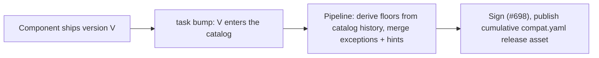
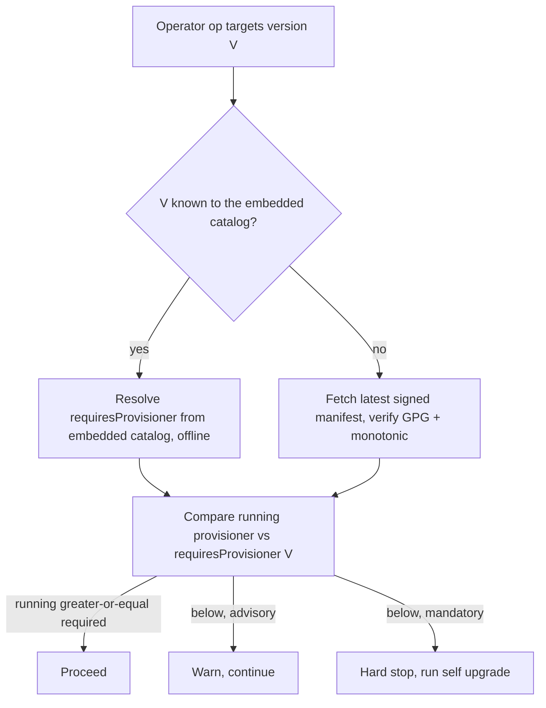

# Operator-triggered self-upgrade, version-check, and compatibility gate

Status: design (not yet implemented). Owner epic: **#500 (Self-Upgrade Protocol)**.
Related: #1231 (state split), #1252 (cluster upgrade), #975, #714.

## Problem

Once `solo-provisioner` is installed there is no signal telling the operator they
must upgrade before running a command. A too-old provisioner can be pointed at a
newer component and do the wrong thing — for example, upgrading a block node with
a provisioner that predates that block-node version. We want a cheap, throttled
check before each command, plus a first-class way to actually upgrade.

Today everything under #500 is framed around the **daemon-triggered** network-upgrade
path (the daemon detects a version change and spawns a detached child). This design
adds the **operator-triggered** entry point and the pre-command checks, reusing the
same mechanism.

## One command, three triggers

`self upgrade` is a single command and a single internal mechanism. It is invoked by:

1. The operator, manually.
2. The daemon, during a consensus-node upgrade window (#716).
3. The pre-command version-check, which only *tells* the operator to run it.

### Scope: converge, do not just swap

Self-upgrade converges the whole provisioner footprint to the target, it does not
only swap two binaries. It re-runs a version-aware self-install (owner, home dirs,
CLI, colocated daemon, sudoers — see `internal/workflows/weaver.go`), runs the
supervised migrations, restarts the daemon, and health-checks. This handles the
"daemon not installed yet" case for free (upgrade-or-install). Already-at-target is
a no-op.

### Binary pairing

The new CLI carries its paired daemon's SHA (`pkg/software/daemon_digest.go`,
`pinnedDaemonDigest`). So: the old CLI downloads and verifies the new CLI, hands off
to it, and the **new** CLI fetches and verifies the matching daemon. This mirrors the
#500 ownership split and removes version-matching guesswork. All downloads go through
the #698 GPG + checksum promote-gate.

### Execution

Detached, via a root-created transient systemd unit (**#1139**, chosen over the
`os/exec` fork in #525). It survives a dropped SSH session and logs to journald.

### Command surface

Mirror `kube cluster upgrade` (#1252) exactly, so operators learn one shape:

- `self upgrade` — one hop, health-gated, re-run to advance.
- `--to vX.Y.Z` — pin the target (still validated by the compat gate).
- `--plan` / `--dry-run` — read-only; no lock taken.

## Pre-command version-check (the nag)

Hooks into `RunPersistentPreRun` (`cmd/cli/commands/common/run.go`), after the
install check and before startup migrations. Commands that opt out via
`SkipGlobalChecks` are unaffected.

- **Throttled.** Store `lastCheckedAt` plus the cached result; only re-fetch the
  latest release when older than the interval (~24h). Short timeout (~2s). A network
  error never fails the command — log at debug, retry next run, back off on failure.
- **Advisory vs mandatory.** Advisory (a newer release exists) prints a warning and
  can be silenced with `--skip-version-check`. Mandatory (below the supported floor,
  or incompatible with the operation) is a hard stop, and `--skip-version-check` is
  **ignored**.
- Skip in non-interactive mode and JSON output. Honor existing proxy settings.
  Air-gapped hosts use the opt-out.

## Compatibility gate

Gate the **operation**, not just the binary. Each component release declares
`requires.provisioner >= X` (plus `upgradeFrom` and `requires.k8s`). An operation on
version V is blocked when the running provisioner is below the requirement. A global
`minSupported` floor is the backstop.

An old binary cannot know a newer component's needs, so the requirement comes from a
**remote manifest** published with each release:

- GPG-signed (releases already ship `.asc`), keyed by component version.
- Carries a **monotonic** manifest version so a replayed old manifest is rejected.
- The cached copy is authoritative once it says "mandatory".

Failure behavior:

- Advisory data unavailable → fail open and warn.
- A mandatory-relevant operation with no manifest and no cache → **fail closed**.
  Air-gapped operators pass `--compat-manifest <path>`. There is no "force past
  mandatory" bypass.
- Local, offline: if the on-disk state's provisioner version is **newer** than the
  running binary, refuse mutating commands (an old binary must not corrupt state a
  newer one migrated).

### Where the compatibility data lives

Compatibility has two directions, and only one can be embedded:

- **Backward-knowable** — "this provisioner supports component versions X…Y." The binary
  knows what it shipped with. Already **embedded** in `infrastructure-catalog.yaml`
  (`pkg/software/config.go`, `//go:embed`). Gives the floor (`minSupported`) and the
  known-good matrix for anything ≤ this release, offline.
- **Forward-unknowable** — "component version V, released *after* this binary, requires
  provisioner ≥ P." An old binary cannot contain this; it comes from the **signed remote
  manifest** (above), fetched by the throttled version-check and cached.

The gate decides locally when the target version is known to the embedded catalog; it
consults the manifest only for versions newer than the binary.

### Ownership and maintenance (decided)

The **provisioner team owns and signs** the manifest — but it is **generated, not authored**,
so ownership is not a tribal-knowledge burden:

- **Catalog membership is the compatibility statement.** Adding version V to the catalog
  (`task bump:*`) asserts "this provisioner supports V." The inverse falls out for free:
  `requiresProvisioner(V)` = the **earliest provisioner release whose catalog contained V**.
  A binary cannot install a component it never integrated, so that *is* the floor.
- **The release pipeline derives the manifest** from catalog history across release tags
  (same philosophy as the #1263 checksum generator), then signs it (#698) and attaches it as
  a cumulative, monotonic release asset.
- **The only hand-maintained part is a small exceptions list** — raise-only overrides for
  when the derived floor is wrong (V shipped in a catalog but a later bug means it needs a
  newer provisioner). A handful of entries, not the whole matrix.
- **Components may supply a `requiresProvisioner` hint** in their own release metadata;
  the pipeline reads it at integration and may only raise the floor. Distributed input,
  centralized signed authority.
- **"Who runs what" is runtime telemetry, not manifest data.** The catalog is the registry
  of managed components; floors derive from it; which operator runs which version is state
  reported through the provisioner's own state layer. Keeping these apart is what makes the
  manifest maintainable.

### Maintenance flow (build / release time)



### Runtime gate (operator command)



### Example compat.yaml

```yaml
# compat.yaml — cumulative; published as a signed release asset (compat.yaml + compat.yaml.asc)
schemaVersion: 1
manifestVersion: 42                 # monotonic; a cached manifest with a higher number is never downgraded
generatedFrom: provisioner@2.4.0    # the release whose pipeline produced this manifest
minSupportedProvisioner: 1.8.0      # global floor — below this, refuse outright

components:
  block-node:
    0.38.0: { requiresProvisioner: ">=1.9.0", source: derived }
    0.39.0: { requiresProvisioner: ">=2.1.0", source: derived }
    0.40.0:
      requiresProvisioner: ">=2.4.0"   # = earliest release whose catalog contained 0.40.0
      upgradeFrom: ">=0.38.0"          # can't jump from older than this in one hop
      source: derived                  # computed from catalog history — nobody typed it

  consensus-node:
    0.7.3: { requiresProvisioner: ">=2.2.0", source: derived }
    0.7.4:
      requiresProvisioner: ">=2.3.0"
      requiresK8s: ">=1.34"
      source: exception                # raise-only override: the derived floor was wrong (later bug)
    0.8.0:
      requiresProvisioner: ">=2.5.0"
      source: hint                     # the component declared this in its own release metadata
```

`source:` records which maintenance path produced each entry: `derived` (computed from catalog
history), `exception` (a raise-only hand override), `hint` (declared by the component).

### Generating the manifest (maintainer command, decided)

Generation is a **command**, not a bash script — the derive-from-catalog-history + merge logic
reuses `pkg/software` and `pkg/manifests`, mirroring the checksum generators (`task
chart-checksums`, the host-binary generator in #1263) and the emerging `catalog` maintainer
group. Proposed: a hidden maintainer subcommand

```
solo-provisioner catalog compat [--write] [--dry-run] [--verify]
```

- **Local use:** a maintainer runs it from the source tree to preview the manifest before a
  release. It needs the catalog plus git tag history, so it is a source-tree tool, not
  something a field binary runs; hidden from the operator surface (see
  `docs/dev/hidden-flags.md`).
- **Generates unsigned.** Signing (#698) stays in the release pipeline — keys are not on a dev
  laptop. CI runs the same command, then signs and publishes the asset. One generator, two
  contexts.
- **`--verify` is a CI lint:** fail if the committed manifest drifts from the catalog.
- Inputs: catalog history + a source exceptions file (e.g. `pkg/software/compat-exceptions.yaml`)
  + component hints ingested at `task bump` time.

## Mandatory dry-run and the plan

Only the **target** binary knows its own migrations, templates, and catalog, so the
plan is produced by the new CLI:

```
old CLI → resolve target → download + verify new CLI
        → new-cli self upgrade --plan   (against current reality)
        → new CLI emits a reviewable plan artifact
        → operator reviews + confirms
        → execute the reviewed plan   (pass the artifact back)
```

This reuses the `plan-migration → migrate` and recovery-plan-artifact (#720)
patterns. The plan classifies each consequence by blast radius:

- binary swap + daemon restart — low, cluster-safe
- template re-render / re-apply (cilium, metallb) — leaks into provisioned clusters
  (see CLAUDE.md workflow reminder #7)
- cluster upgrade — high, node downtime
- component config change

### Plan persistence

- The artifact captures the **resolved migration set by id**, not just prose, so
  apply equals what was shown.
- Version/hash the artifact and **reject a stale plan** — re-plan if reality drifted
  between plan and apply.
- The same artifact is reused by the operator and daemon triggers.

## Version resolution

"Latest on GitHub" is the wrong default. The reachable target is a function of local
state. Resolution is a small solver:

1. Read local state: provisioner version, cluster k8s version, deployed components.
2. Fetch the release index plus per-release compat metadata (the signed manifest).
3. Pick the highest version reachable in **one hop** without violating `upgradeFrom`,
   component compat, or the k8s requirement.
4. If the latest needs two hops, recommend the next hop — one hop at a time, like
   #1252.

## Cluster upgrade: block and instruct, scoped

A cluster upgrade is a **consequence** of the binary upgrade, not a precondition —
the new binary's catalog is what knows the new k8s version. Blocking the swap on
cluster state would deadlock (you could never get the binary that knows how to drive
the cluster forward). So:

- Self-upgrade completes the node-safe **binary swap**, then **stops before any
  cluster-affecting work** and instructs: "run `kube cluster upgrade --plan`".
- Block the cluster cascade, not the swap. Never silently perform a cluster upgrade.

## Daemon (non-interactive) vs operator (interactive)

`self upgrade` runs in two very different contexts, and the decision authority differs.

**Operator, interactive.** The operator reviews the plan, is prompted, and confirms or
aborts. Block-and-instruct shows a message and stops.

**Daemon, detached, during a CN upgrade window.** There is no one to prompt, and a
detached process must never block on input — the HIP termination guarantee requires every
operation in the window to reach a terminal state. So the daemon does not prompt. It
evaluates the plan against an **autonomous-execution envelope** and either proceeds or
halts.

### The envelope (wider)

The daemon may autonomously do what #1274 (daemon-orchestrated cluster-infra convergence)
sanctions — including driving a cluster upgrade — because that is the deliberate,
policy-bounded path for unattended convergence. It is still non-interactive and bounded by
policy; it is not a blank cheque.

Anything outside the sanctioned envelope, or any genuine failure, is a **fatal halt**:

- set `DaemonResult=False` with a specific reason (e.g. `ClusterUpgradeRequired`,
  `ClusterAffectingMigration`, or an incompatibility from #714)
- write `status: failed` to the self-upgrade state, with the `pending` pointer and the
  persisted plan
- emit `SelfUpgradeFailed` (#530), leave `.bak` intact for recovery (#528)
- log a structured journald error

A transient failure (a network blip fetching the plan or a binary) retries within the
deadline instead of halting, per the #500/#502 fatal-vs-transient contract.

The persisted plan plus the reason are the machine-readable equivalent of the message a
human would have seen — consumed by `consensus node upgrade-diagnose` (#718) and by resume.

### Resume after a halt

A halted daemon self-upgrade hands off to a human. The operator runs
`self upgrade --resume`, which is the **interactive** counterpart:

- it keys off the `selfUpgrade:` breadcrumb (the `pending` pointer + the plan pointer)
- it **re-derives reality** — the saved plan may be stale — and re-plans on drift
- it shows the plan and the problems the daemon hit, prompts, and continues or rolls back

Two halt shapes to keep distinct:

- **Policy halt before the swap** (e.g. "cluster upgrade required"): binaries unchanged,
  nothing to roll back — the state records the pending work and waits for resume.
- **Failure during the swap**: `.bak` auto-recovery (#528) restores both binaries on the
  next daemon start; the operator then diagnoses and retries.

Both are terminal and logged; the difference is only whether the binaries changed. This
diagnose → resume handoff parallels the `consensus node upgrade-diagnose` →
`upgrade-recover` pair (#718 / #717); reconcile whether `self upgrade --resume` reuses that
machinery or is a sibling.

## Migration redesign (prerequisite)

Startup migrations auto-run on every invocation in `RunPersistentPreRun`. After a
swap, the next command would silently re-apply cluster config — an ambush. #1252
already forbids version advancement through startup migrations; this extends that.

Tier every migration by blast radius:

- **Local / state-only** (state schema, helm-release v2, mgmt-ports,
  traffic-shaping): safe, keep auto-running so the new binary can read old state.
- **Cluster-affecting** (cilium / metallb re-apply): **never auto-fire**. Enumerated
  in the plan and run by self-upgrade under confirmation.

Replace silent self-heal with **detect-and-instruct**: a pending cluster migration
makes the next command refuse with "run `self upgrade --resume`", it does not apply.
Trade-off: we lose automatic self-heal of old-binary clusters — that self-heal *is*
the ambush — so call it out in the PR's Risks section. Every migration in
`RegisterMigrations()` must be audited and classified once.

## State breadcrumb — reality always wins

The durable breadcrumb lives in the provisioner-specific state file from the state
split (#1231), in a new `selfUpgrade:` section:

- last check result (timestamp, advisory/mandatory, latest-reachable)
- a `pending` pointer, e.g. `pendingClusterUpgrade: {to, sinceVersion}`
- a pointer (path + hash) to the last plan, not the plan itself

Load-bearing rule: the breadcrumb can only **trigger** (remind, offer `--resume`),
never **authorize**. Reality — on-disk binary versions, live cluster k8s version,
deployed components — is always re-derived before any mutation. On disagreement,
reality wins and the breadcrumb is corrected or cleared. This is the same
reality-over-state discipline used elsewhere (reconfigure trigger, #1252 planner).

Self-upgrade's core can run from reality plus the persisted plan **without** the
breadcrumb, so the state split does not block it — the breadcrumb is a convenience
that survives a dropped session or a reboot mid-ladder.

## Single-writer lock

One lock guards **any** mutating convergence run, human or daemon: operator
`self upgrade`, operator `kube cluster upgrade`, and the daemon driving either. It is
defined once (in #1272) and designed to guard the daemon **from the start**, not
widened later. A writer that cannot take the lock refuses while it is held.
`--plan` / `--dry-run` are read-only and take no lock.

## Consistent upgrade grammar across the three layers

The provisioner exposes three "converge to a target version" commands, one per layer, and
they deliberately share one grammar so operators learn it once:

| command | layer | converges |
|---|---|---|
| `self upgrade` | provisioner | CLI + daemon binaries (+ #1274 cluster/infra) |
| `kube cluster upgrade` (#1252) | cluster | k8s / Cilium / charts |
| `consensus node upgrade` | consensus node | the CN deployment on this cluster |

Shared flags on each:

- `--to vX.Y.Z` — pin the target (resolve to the latest patch of a minor, bounded
  ≥ installed and ≤ catalog default), as in #1252.
- `--plan` — the whole remaining ladder, read-only, no lock.
- `--dry-run` — the next hop + preflight, read-only.
- `--resume` — continue a halted run forward, from that layer's breadcrumb.
- `--diagnose` — read-only inspection of a failed run: structured diagnosis + a reviewable
  recovery-plan artifact (#720), plus a Tier-2 escalation tarball.
- `--recover` — the mutating repair / rollback (restore `.bak`, fix drift).

`--diagnose` / `--recover` are exposed on every surface for consistency but implemented
once, via the shared diagnose → recover machinery (#718 / #717) and the #720 recovery-plan
schema — thin aliases, not per-command reimplementations. The single-writer lock (#1272)
guards every mutating mode on all three; the read-only modes take no lock.

### Manual consensus-node upgrade is NOT the network freeze flow

`consensus node upgrade --to X` is a **managed in-place replace** of the CN deployment on
this cluster — closer to uninstall + install, walking any intermediate cluster/infra
migrations (the hop check decides whether the jump is possible). It does **not** freeze the
network or run the HIP prepare/freeze coordination, and it accepts node downtime like a
reinstall.

That is a different mechanism from the **network-coordinated** CN upgrade — the beacon/CR-
driven execute phase (#502), which freezes and coordinates across the fleet and is daemon-
driven. Both exist and serve different scenarios:

- manual / single-deployment convergence → `consensus node upgrade` (operator-initiated)
- network-coordinated upgrade → the execute phase (beacon/CR-initiated, daemon-driven)

The same `consensus node upgrade --resume` / `--diagnose` / `--recover` flags own the
lifecycle of a halted upgrade **regardless of which path initiated it**. It should reuse the
CN install/execute step bodies, not reimplement them. On `mainnet` a manual `--to` upgrade
**warns and requires explicit operator confirmation** — a single node upgrading outside the
coordinated freeze can diverge from a live network — rather than a hard block; `local` /
`testnet` run without the prompt.

`--diagnose` / `--recover` fold the #718 `upgrade-diagnose` / #717 `upgrade-recover` verbs
into flags on `consensus node upgrade`: the BLL and the #720 recovery-plan schema are
unchanged, only the command spelling moves. The standalone verbs are dropped (optionally
kept as hidden aliases for one release).

## How this relates to the state-split and cluster-upgrade epics

All three stand on one shared foundation that must be singular and land once:
managed-shape version state, reality detection + RSL/BLL planner, the single-writer
lock, and migration tiering.

Landing order:

1. **State split + managed-shape version tracking (#1231, #1264)** — the source of
   truth and the home for the `selfUpgrade:` section. (Group A new-install fixes
   #1258–#1261 are independent and run in parallel.)
2. **#1252 Phase 2 cluster multi-hop engine** — builds the reusable planner
   (#1266 reality, #1267 resolver) and the lock (#1272). Migration tiering lands
   here.
3. **Self-upgrade (#500)** — reuses that machinery, needs `kube cluster upgrade` to
   exist for block-and-instruct, and #1274 wires the daemon to drive the engine.

Parallelization: self-upgrade splits into (a) the binary-swap mechanism
(download / verify / detached child / `.bak` / paired digest), which is independent
of the cluster engine and can be built alongside Phase 2; and (b) the planner surface
(dry-run, compat resolution, block-and-instruct, persisted plan), which depends on
the cluster engine's reality + resolver + lock. Shipping (b) before the cluster
planner forces throwaway stubs.

## Epics and stories to update or create

### Epics to update

| Epic | Change |
|---|---|
| **#500** Self-Upgrade Protocol | Broaden the epic body from "two-binary flow triggered when a version changes" (daemon-only) to include the operator-manual trigger, the pre-command version-check and compat gate, the planner/dry-run surface, and the migration-tiering prerequisite. |
| **#1231** state split | Add the `selfUpgrade:` section to the provisioner-specific state file as a consumer requirement (reality-over-state breadcrumb). |
| **#1252** cluster upgrade | No body change; cross-reference the landing order and confirm the #1272 lock is scoped to guard the daemon too. |

### Stories to update

| Story | Change |
|---|---|
| **#523** `self upgrade` subcommand | Clarify it is the **same** command for the operator-manual and daemon-spawned triggers; add "converge, not just swap" scope. Keep the detached-child mechanism here; move the operator UX + planner to a new story (below). |
| **#525 / #1139** detached child | Resolve the fork in favor of **#1139** (transient systemd unit); close or mark #525 superseded. |
| **#529** self-upgrade state file | Reconcile location with #1231 — the breadcrumb belongs in the split's provisioner file, not a standalone daemon file. |
| **#975** daemon compat range | Cross-link: its daemon-restart/converge policy overlaps the "converge" scope decision. |
| **#1272** single-writer lock | Acceptance criteria must state the lock guards human **and** daemon runs from the start. |

### New stories to create (under #500)

1. **Operator `self upgrade` entrypoint + mandatory dry-run/plan** — operator trigger,
   planner produced by the new binary, persisted + hashed plan artifact, mirror
   #1252 `--to` / `--plan` / `--dry-run`, block-and-instruct scoping.
2. **Pre-command version-check nag** — throttled `lastCheckedAt` cache, advisory vs
   mandatory, `--skip-version-check` (ignored when mandatory), honor proxy, skip
   non-interactive / JSON.
3. **Operator-operation compatibility gate + signed remote compat manifest** —
   `requires.provisioner` / `upgradeFrom` / `requires.k8s`, GPG-signed, monotonic,
   fail-closed for mandatory; local "state newer than binary" refusal. (May extend
   #975 rather than stand alone.)
4. **Version-resolution solver** — highest one-hop-reachable target from state +
   manifest. May fold into story 1 or 3.
5. **Migration redesign: tier by blast radius** — local auto-run vs cluster-affecting
   explicit; detect-and-instruct replaces silent self-heal; audit
   `RegisterMigrations()`. Cross-cutting; relates to the #1252 guardrail.
6. **`selfUpgrade:` breadcrumb section** — in the provisioner state file; filed under
   **#1231**, consumed by #500.
